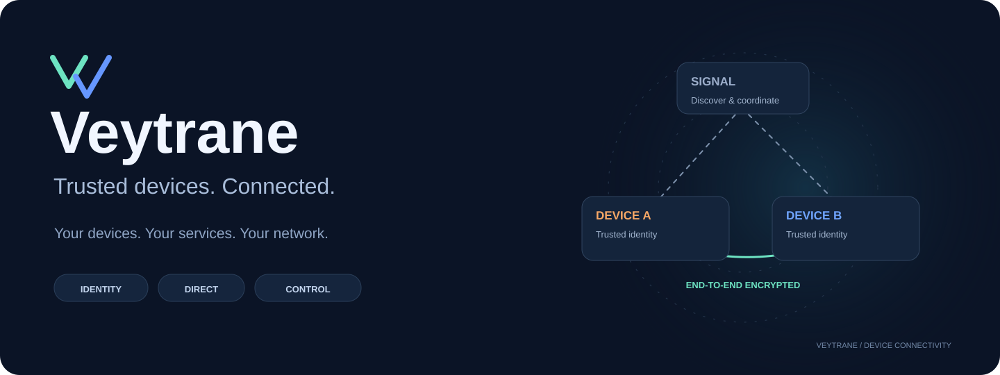
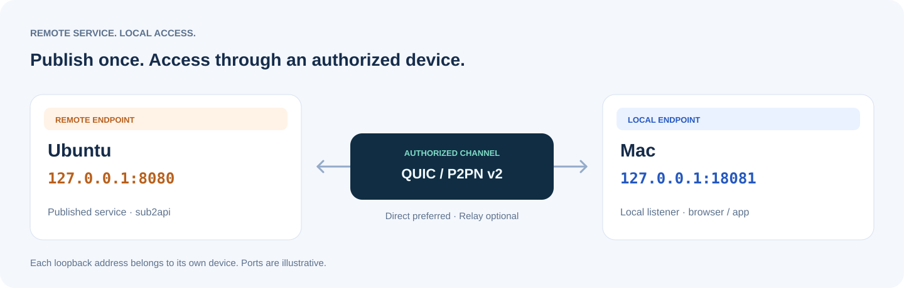
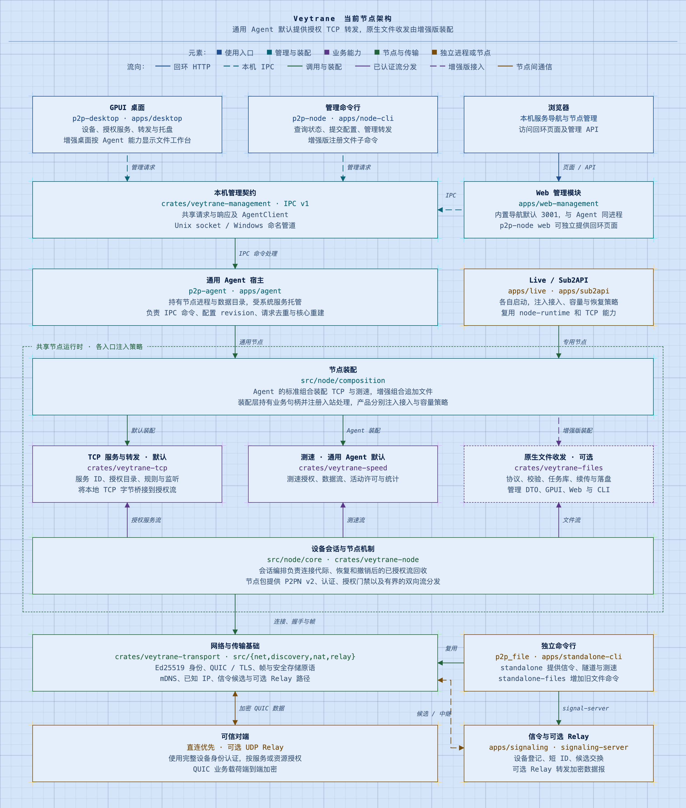

<p align="center">
  
</p>

<p align="center">
  <strong>远程直连，把授权的 TCP 服务映射到本机。</strong><br>
  两端只需运行 Agent，一端有可达的 UDP 地址即可无信令直连。
</p>

<p align="center">
  <a href="#快速开始">快速开始</a> ·
  <a href="#使用前提">网络条件</a> ·
  <a href="#系统架构">系统架构</a> ·
  <a href="architecture/layer-review.html">交互架构图</a> ·
  <a href="#部署与平台">部署与平台</a> ·
  <a href="#文档导航">文档导航</a>
</p>

# Veytrane

Veytrane 是用 Rust 构建的跨网 TCP 端口转发工具。把家里、办公室或云主机上的 SSH、Web 面板和文件共享服务映射到本机回环端口，通过经过认证的 QUIC 通道访问。标准版即可使用。原生桌面、文件收发和自建信令按需部署。

**Rust · QUIC / TLS 1.3 · Ed25519 · P2PN v2 · MIT**

## 快速开始

以下以个人电脑通过公网直连远端 Linux、访问 SSH 为例。可以把 SSH 换成远端任意明确授权的 TCP 服务。

### 1. 两端构建并启动 Agent

macOS / Linux 需要 Rust / Cargo **1.90.0 或更高版本**及系统编译工具链。两端使用同一源码版本，各执行一次：

```sh
git clone https://github.com/gloryhui/Veytrane.git
cd Veytrane
cargo build --locked --release --bin p2p-agent --bin p2p-node

# 仅首次初始化；已有节点沿用原数据目录
target/release/p2p-node init
target/release/p2p-agent --no-navigation
```

这条命令构建标准版 Agent 和管理 CLI。日常只运行 `p2p-agent`。`p2p-node` 用于配置和排查，桌面和文件增强版可按需安装。

### 2. 远程 IP 直连

**主动连接的一端须能访问对端 Agent 的 UDP 端口。** 公网 IPv4 位于路由器时，将一个公网 UDP 端口映射到 Agent。使用公网 IPv6 时，确认路由可达并允许对应 UDP 入站。

在远端另开终端，通过 `p2p-node status` 获取完整 NodeId，通过 `p2p-node nearby` 查看实际 UDP 监听地址。默认监听端口由系统分配。长期使用公网入口时，建议先按[直连配置说明](docs/SIGNAL_FREE_CONNECTIVITY.md#持久配置与端口)固定 `direct.listen_port`，再配置防火墙或路由器映射。对外只需开放这一条 Agent UDP 入口，SSH 和本机管理页继续使用各自的回环地址。

首次认证前，在远端读取 `p2p-node config` 返回的当前 revision，再通过标准输入设置远程访问密码。下面的 `0` 适用于刚初始化、尚未改过配置的节点，命令需要 Python 3 隐藏输入：

```sh
python3 -c 'import getpass,sys;sys.stdout.write(getpass.getpass("远端节点密码："))' \
  | target/release/p2p-node password --revision 0
```

在客户端用远端完整 NodeId、可达 IP 和 **Agent UDP 端口**连接。替换示例里的 ID 和地址，IPv6 使用 `[地址]:端口`：

```sh
python3 -c 'import getpass,sys;sys.stdout.write(getpass.getpass("远端节点密码："))' \
  | target/release/p2p-node connect-address '远端完整NodeId' '203.0.113.10:9000' --password-stdin
```

有可达地址时，`signal_server` 留空即可。双方都在 NAT / CGNAT 后且缺少可达 UDP 入口时，按[网络条件](#使用前提)选择信令打洞或 Relay。

### 3. 发布服务并验证一条转发

首次配置可在两个节点分别临时运行以下命令。打开该节点的回环管理地址 `http://127.0.0.1:8787/`，使用命令输出所指文件内的管理 token。远端无桌面时，可通过既有 SSH 隧道访问远端回环管理页。

```sh
target/release/p2p-node web --listen 127.0.0.1:8787
```

1. **远端新增服务**。服务 ID 填 `ssh`，目标填远端可达的 `127.0.0.1:22`，允许设备填客户端完整 NodeId，启用并保存。
2. **客户端新增转发**。输入远端完整 NodeId，查询授权服务。转发规则的服务 ID 填 `ssh`，本地监听填 `127.0.0.1:2222`，勾选「启用」和「自动启动」并保存。需要重启后继续直连时，在「保存直连地址到草稿」后提交配置，并按需保存可信设备授权。
3. **客户端实测**。运行 `ssh -p 2222 用户名@127.0.0.1` 验证远端 SSH。保存配置后可退出临时 Web 管理，Agent 继续提供转发。

全程用 CLI 时，使用 `p2p-node config` 读取 `result.settings` 和 revision，修改设置草稿后执行 `p2p-node apply <草稿.json> --revision <当前值>`。服务和转发字段见[服务契约](docs/specs/NODE_SERVICES.md)。验证通过后，先结束前台 Agent，再按[节点宿主安装说明](packaging/node/README.md)用 `node-host.py` 设置 systemd、LaunchAgent 或 Windows 计划任务常驻。

## 使用前提

**局域网或已知可达 IP 地址可以不使用信令服务器。** 当前通用 Agent 已支持局域网自动发现和指定 IP 直连，桌面、CLI、Web 共用同一后台身份与授权。未配置信令时，Agent 不访问公共信令、STUN 或 Relay 服务。

如果两端位于不同网络、没有可直接访问的地址，且需要按设备 ID 自动发现与协调打洞，仍需准备一台双方可访问的信令服务器，通常部署在自建云主机上；项目作者后续可能提供公共信令服务，当前没有默认公共入口。**两个分别隔离在 NAT 后面的设备，若没有信令、已知可达地址或其他协调渠道，仍不建议使用本软件来期待自动跨网互联。**

### 当前连接能力

| 网络场景 | 当前通用 Agent 的支持情况 | 必要条件与限制 |
| --- | --- | --- |
| 同一局域网，不配置信令 | **支持 mDNS 自动发现，选择设备后认证连接** | 启用 `direct.enabled` 与 `direct.lan_discovery`（默认启用），允许局域网组播与所需 UDP；访客隔离或组播受限时可手动填 IP。 |
| 已知可达的内网 IPv4 / IPv6 地址 | **支持 IP:端口直连，无需信令** | 必须提供对方完整 NodeId，不能用 IP 替代身份校验；IPv6 使用 `[地址]:端口`。 |
| 双方有全球可路由 IPv6 | 支持无信令 IP 直连 | 需要知道对端当前地址和 UDP 端口，路由与防火墙允许；仅有 `fe80::` 不满足跨网条件。 |
| 至少一方有公网 IPv4 | 支持向该端发起无信令 IP 直连 | 公网 UDP 入口必须可达；地址在路由器上时需正确映射到 Agent 实际监听端口。无需双方都有公网 IPv4。 |
| 双方都在 NAT / CGNAT 后面，缺少可达地址 | 使用信令交换候选并尝试打洞 | 成功率取决于 NAT 和防火墙，失败时需可选 Relay；信令本身不等于中继，也不保证任意网络都连通。 |

所有路径均执行相同的 Ed25519 / TLS 会话绑定、P2PN v2 协商、密码或可信设备认证及资源授权。发现记录只提供未经认证的地址提示，**不会自动连接、自动信任或授予权限**。九位短设备 ID 仍由信令分配与解析；无信令连接使用完整 NodeId。

实现已通过 IPv4 / IPv6 本地真实 QUIC、身份与密码负例以及隔离 Agent 进程回归；局域网发现、文件校验、TCP 转发和授权撤销也有端到端测试。公网 IPv6、单端公网 IPv4 的具体运营商拓扑仍须分别实测，不能用本地回归代替公网验收。详细步骤见[无信令发现与 IP 直连](docs/SIGNAL_FREE_CONNECTIVITY.md)。

## 可以用它做什么

| 场景 | 使用方式 |
| --- | --- |
| 访问远端应用与管理面板 | 将远端发布的授权服务映射到本机端口，用浏览器或原有客户端访问。 |
| 连接家中或办公室设备 | 通过自建信令发现设备，完成身份认证与远程访问认证，按资源授予权限。 |
| 原生文件与目录收发（可选） | 两端使用文件增强版并启用文件能力后，可使用分片校验、暂停与继续、目录预览、增量发送、限速和任务历史。 |
| 在无桌面服务器上常驻 | Agent 由 systemd、launchd 或 Windows 当前用户登录任务托管；管理界面通过本地 IPC 接入。 |
| 为特定用途分发客户端 | 使用 Veytrane for Sub2API 独立网关与 Windows 专用包，仅开放指定服务。 |
| 排查连接问题 | 查看连接阶段、Direct / Relay 路径与授权状态，并使用设备间测速辅助定位问题。 |

### 把远端服务接入本机

下面以访问远端 Web 服务为例。远端节点发布 `sub2api` 服务，并指定哪些设备可以使用；本地节点选择这个服务，将它绑定到回环端口。



浏览器访问 `http://127.0.0.1:18081/`，请求经本地 Agent 到达远端服务。远端图中的 `127.0.0.1` 指 **Ubuntu 自己的回环地址**；本地图中的 `127.0.0.1` 指 **Mac 自己的回环地址**。图中端口为说明示例，实际以各节点配置为准。

TCP 转发按服务 ID 与授权目录开流。服务发布、设备白名单和本地映射分别控制“提供什么”“谁能访问”和“从哪里访问”；仅建立设备连接不会自动开放全部服务。详见[服务契约](docs/specs/NODE_SERVICES.md)与[授权模型](docs/specs/NODE_AUTHORIZATION.md)。

## 设备如何连接

1. **取得对端地址**：同一局域网通过 mDNS 发现，或手动提供完整 NodeId 与 IP:端口；需要跨 NAT 协调时再使用信令与 STUN。
2. **建立通道**：尝试可用的 IPv4 / IPv6 路径与打洞候选，优先建立 QUIC 直连。
3. **验证身份与权限**：Ed25519 身份握手绑定当前 TLS 会话；远程密码或可信设备认证通过后，再检查相应资源权限。
4. **承载业务**：按各自授权转发 TCP 服务或测速。文件增强版可以在同一节点会话上收发文件。

Direct 连接成功时，业务数据在设备间传输，信令服务器负责发现和连接协调。配置可选 UDP Relay 后，直连无法及时建立时可回退到中继；Relay 转发端到端加密的 QUIC 数据报。是否能直连取决于双方网络和 NAT 条件。

## 系统架构

通用版由**一个常驻 Agent 持有节点状态，桌面、CLI 和 Web 经本机 IPC 管理同一个节点**。授权 TCP 转发是标准版的默认业务。文件增强版在同一会话、认证和授权机制上装配文件能力。



[打开新版交互架构图](architecture/layer-review.html)可在本地浏览器离线查看，支持八种主题、独立亮暗切换和整图 PNG 导出。

| 层次 | 主要模块 | 职责 |
| --- | --- | --- |
| 网络与传输 | [`veytrane-transport`](crates/veytrane-transport)、`src/{net,discovery,nat,relay}` | Ed25519 身份、QUIC / TLS、帧、发现、建连和可选中继。 |
| 节点核心 | [`veytrane-node`](crates/veytrane-node)、[`src/node/core`](src/node/core) | P2PN v2、认证与授权、连接代际、重连、强撤销和有界流分发。 |
| 默认业务 | [`veytrane-tcp`](crates/veytrane-tcp)、[`veytrane-speed`](crates/veytrane-speed) | TCP 服务发布、授权目录、本地监听与字节桥接，以及单独授权的测速。 |
| 可选文件业务 | [`veytrane-files`](crates/veytrane-files) | 文件协议、完整性校验、配置、任务库、续传、管理 DTO、GPUI、Web 和 CLI。启用后复用节点会话、授权和传输。 |
| 宿主与装配 | [`apps/agent`](apps/agent)、[`src/node/composition`](src/node/composition) | 持有 Agent 所有权和数据目录，处理配置 revision、请求去重、启停与核心重建，按版型装配业务。 |
| 管理契约与入口 | [`veytrane-management`](crates/veytrane-management)、[`apps/desktop`](apps/desktop)、[`apps/node-cli`](apps/node-cli)、[`apps/web-management`](apps/web-management) | IPC v1 的请求、响应与客户端，以及 GPUI、管理 CLI 和回环 Web。内置导航按配置在 Agent 进程中提供 `3001`，`p2p-node web` 可在独立进程中运行。 |
| 专用产品与独立 CLI | [`apps/live`](apps/live)、[`apps/sub2api`](apps/sub2api)、[`apps/standalone-cli`](apps/standalone-cli)、[`apps/signaling`](apps/signaling) | Live 与 Sub2API 复用节点装配与 TCP。`p2p_file` 提供独立隧道、测速和信令入口，旧式文件命令随 `standalone-files` 构建。 |

添加业务时，由入口选择能力并向节点装配层注入策略，业务包复用节点提供的会话、授权和流分发。文件增强版采用这条路径，移除文件包后的标准 Agent、CLI 和桌面已有独立演练记录。[分层说明](docs/REPOSITORY_LAYOUT.md) · [Agent API](docs/specs/NODE_AGENT_API.md) · [P2PN v2](docs/specs/NODE_WIRE.md) · [施工与验收](architecture/tcp-default-files-optional-plan.md)

### 进程与入口

| 入口 | 用途 |
| --- | --- |
| `p2p-agent` | 常驻无 GUI 节点，持有身份、连接和转发监听。文件增强版启用后管理文件任务。 |
| `p2p-node` | 管理同一 Agent 的 CLI。`p2p-node web` 可启动只监听回环地址的管理网关。 |
| `p2p-desktop` | GPUI 工作台，通过 IPC 管理 Agent。标准桌面用 `desktop-client`，增强桌面用 `desktop-files`。 |
| `p2p_file` | 独立 CLI。`p2p_file signal-server` 可自建信令，负责发现和候选交换，并支持可选 TLS 与 UDP Relay。 |
| `p2p-sub2api-gateway` / `sub2api-client` | 独立的 Sub2API 专用组合，使用独立身份和受限服务范围。 |

产品与仓库名为 **Veytrane**。当前 Cargo 包名、可执行命令和数据路径仍沿用现有内部标识；源码目录更名不会迁移身份或配置。

## 可选安装

### 文件增强版

| 版型 | Agent、CLI 与 Web | GPUI | 文件能力 |
| --- | --- | --- | --- |
| 标准版（默认） | `agent-standard` | `desktop-client` | 提供 TCP 转发和测速。原生文件收发未编入发行二进制。 |
| 文件增强版 | `agent-full` | `desktop-files` | 追加 `veytrane-files` 的执行和各入口。两端须显式启用文件能力并完成授权。 |

默认 Cargo 构建和发行脚本使用标准版。增强版 Agent、CLI 可用 `--no-default-features --features agent-full` 构建。发行脚本通过 `--with-files`（PowerShell 为 `-WithFiles`）生成文件增强包。两种版型共用数据目录、IPC v1 和节点协议，初始配置均关闭文件能力。已有节点切回标准版前，按[宿主升级说明](packaging/node/README.md)先关闭文件能力。

### 原生桌面

桌面构建需要对应平台的图形依赖，见[桌面构建与运行](packaging/RUNNING.md)。
```sh
cargo build --locked --release --no-default-features --features desktop-client --bin p2p-desktop
cargo build --locked --release --no-default-features --features agent-standard --bin p2p-agent --bin p2p-node

target/release/p2p-desktop
```

安装时使用同一提交与版型的桌面、Agent 和 CLI。标准桌面首页提供设备、授权服务目录和转发。增强版通过桌面设置启用文件能力，CLI 提供 `send`、`preview-directory`、`pause` 和 `resume` 等命令。

主窗口关闭按钮会收起到托盘，托盘不可用时保留任务栏入口。托盘菜单“退出 Veytrane”退出桌面，后台 Agent 继续提供转发。需要停用后台时使用节点管理的停止入口。发行组合及平台依赖见[桌面构建与运行](packaging/RUNNING.md)。

### 自建信令服务器

在可被双方访问的服务器上运行：

```sh
cargo build --locked --release --no-default-features --features standalone --bin p2p_file

# 在可写的专用工作目录运行；数据库保存短设备 ID 的长期映射
target/release/p2p_file signal-server   --listen 0.0.0.0:8900   --short-id-db ./signal-device-ids.sqlite3
```

将可访问的信令 `HOST:PORT` 填入两端配置，保存后重启 Agent。无桌面时按[节点宿主说明](packaging/node/README.md#构建和首次配置)停机执行 `offline-apply`。默认信令使用 TCP，启用可选 UDP Relay 时另行配置相应 UDP 端口。证书、主机名校验及设备端配置见[信令 TLS](docs/SIGNALING_TLS.md)。

## 部署与平台

| 形态 | 目标环境 | 说明 |
| --- | --- | --- |
| 通用 Agent + CLI / Web | macOS、Linux、Windows | 共用节点核心，支持标准版和文件增强版。Mac、Ubuntu、Windows 的现有生产节点已完成 `de9af87` 标准版换版。 |
| 原生桌面 | macOS、Windows、Linux | GPUI 窗口与系统托盘；系统依赖、打包与签名按平台核验。 |
| Sub2API 专用客户端 | Windows x64 | 分发包仅提供固定服务入口；已交叉构建并检查制品，Windows 实机验收尚未完成。 |
| 信令 / 可选 Relay | 可公网访问的服务器 | 与设备业务分离，按实际启用的监听端口部署。 |

常驻安装由 [node-host.py](scripts/node-host.py) 与平台宿主管理。安装工具使用不可覆盖的版本目录；配置、身份和任务单独保存。数据目录默认位置如下，所有管理入口须指向同一个目录：

| 平台 | 默认节点数据目录 |
| --- | --- |
| macOS | `~/Library/Application Support/p2p-file/node` |
| Linux | `$XDG_DATA_HOME/p2p-file/node`，未设置时为 `~/.local/share/p2p-file/node` |
| Windows | `%LOCALAPPDATA%\p2p-file\node` |

自定义目录使用 `--data-dir`。持续升级时保留身份、授权、任务和映射，先备份再按宿主流程操作；具体命令与恢复边界见[节点安装、升级与恢复](packaging/node/README.md)。

平台资料：[macOS Apple Silicon](packaging/macos-arm64/README.md) · [macOS Intel](packaging/macos-x86_64/README.md) · [Windows x64](packaging/windows-x64/README.md) · [Linux x86_64](packaging/linux-x86_64/README.md) · [Sub2API 专用包](packaging/sub2api-windows/README.md) · [直播专用版](packaging/live/README.md)。

## 安全与访问边界

- **设备身份**：每个节点拥有独立 Ed25519 身份；握手绑定当前 QUIC / TLS 会话，避免仅依赖自签证书识别设备。
- **权限分开授予**：身份认证、远程访问认证、文件/测速资源和 TCP 服务授权是不同检查。对端支持某能力，不代表已获得使用权限。
- **本机管理边界**：Web 仅允许回环监听，并要求管理 token。远程管理应通过已授权的服务映射或 SSH 隧道接入。
- **文件完整性**：传输使用分片 BLAKE3 校验与接收路径校验，校验完成后发布文件；支持持久任务恢复。
- **信令与中继可见性**：信令可观察设备地址与牵线关系，中继可观察包大小和时序；中继不解密业务载荷。默认明文信令可能被干扰连接协调，部署时可配置严格校验的 TLS。
- **凭据管理**：私钥、管理 token、密码、完整私有配置和带嵌入凭据的专用包不应提交到源码仓库。Sub2API 专用包的共享凭证与撤销边界见[分发说明](packaging/sub2api-windows/README.md)。

协议与认证细节：[远程认证](docs/REMOTE_AUTH.md) · [授权模型](docs/specs/NODE_AUTHORIZATION.md) · [节点协议](docs/specs/NODE_WIRE.md) · [信令 TLS](docs/SIGNALING_TLS.md)。

## 开发与验证

宿主和打包脚本的检查需要 Python 3.11 或更高版本。

```sh
# 架构依赖
python3 scripts/check-architecture.py

# Rust 格式、编译与回归
cargo fmt --all -- --check
cargo check --locked --all-features --all-targets
cargo test --locked --all-features --all-targets --no-fail-fast -- --test-threads=4

# 安装宿主与桌面打包检查
python3 scripts/node-host-tests.py
python3 scripts/package-desktop-tests.py
```

默认 TCP、可选文件拆分的 P1–P5 已结项，覆盖三平台候选、换版与文件包移除演练。三端生产节点已完成标准版切换，Windows 还通过独立的重新登录触发计划任务和文件增强版双向收发验收。Windows 生产管理入口 `3001` 换版前后均返回 HTTP `400`，该页面功能未纳入通过范围。[最终验收汇总](architecture/tcp-default-files-optional-plan.md#p1p5-最终验收汇总) · [三端生产部署](architecture/tcp-default-files-optional-plan.md#三端生产标准版部署汇总) · [Windows 验收记录](docs/task-reports/WINDOWS_SCHEDULED_TASK_EDITION_ACCEPTANCE.md)

## 文档导航

| 要了解什么 | 文档 |
| --- | --- |
| 交互式查看模块与源码 | [节点架构图](architecture/layer-review.html)、[仓库分层](docs/REPOSITORY_LAYOUT.md) |
| 安装、常驻、升级与恢复 | [节点宿主说明](packaging/node/README.md)、[生命周期契约](docs/specs/NODE_HOST_LIFECYCLE.md) |
| 管理 API 与配置事务 | [Agent API](docs/specs/NODE_AGENT_API.md)、[配置契约](docs/specs/NODE_CONFIG_P1.md) |
| 无信令局域网发现 / IP 直连 | [使用与配置](docs/SIGNAL_FREE_CONNECTIVITY.md) |
| 设备认证、授权与服务目录 | [远程认证](docs/REMOTE_AUTH.md)、[授权模型](docs/specs/NODE_AUTHORIZATION.md)、[TCP 服务](docs/specs/NODE_SERVICES.md) |
| 文件、增量发送与任务管理 | [文件契约](docs/specs/NODE_FILES.md)、[增量发送](docs/DESKTOP_INCREMENTAL_SEND.md)、[任务管理](docs/TASK_MANAGEMENT.md) |
| 限速、测速与连接排查 | [文件限速](docs/TRANSFER_LIMITS.md)、[连接诊断](docs/CONNECTION_DIAGNOSTICS.md) |
| 专用客户端与网关 | [Veytrane for Sub2API](packaging/sub2api-windows/README.md) |
| 独立 CLI 的 serve / tunnel / push 等命令 | [独立 CLI 使用指南](docs/STANDALONE_CLI.md)、[动态转发](docs/CLI_DYNAMIC_TUNNEL.md) |
| 部署版本与验证证据 | [三端标准版部署验收](architecture/tcp-default-files-optional-plan.md#三端生产标准版部署汇总)、[历史部署记录](docs/task-reports/VEYTRANE_DEPLOYMENT.md)、[任务记录索引](docs/task-reports/IMPLEMENTATION_STATUS.md) |

## 许可证

[MIT License](LICENSE)。第三方组件及共享代码归属见 [THIRD_PARTY_NOTICES.md](docs/gpui-mvp/THIRD_PARTY_NOTICES.md)。
