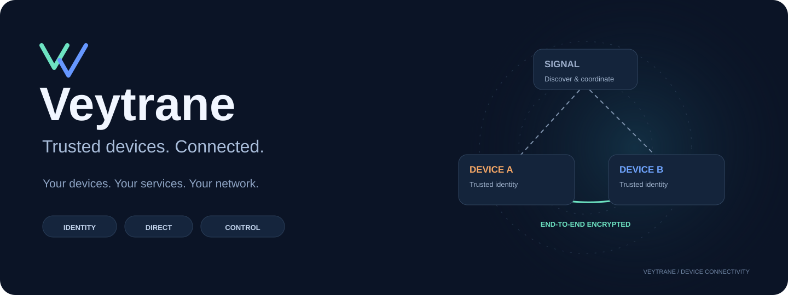
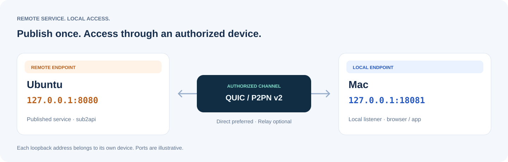
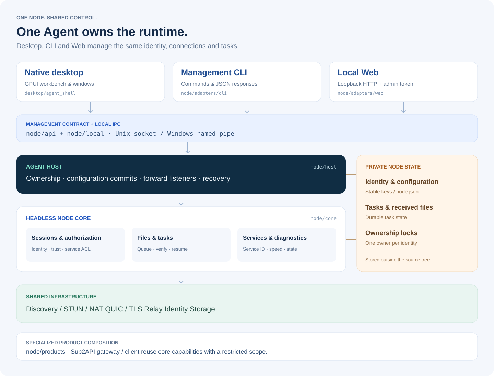

<p align="center">
  
</p>

<p align="center">
  <strong>可信设备，跨网络互联。</strong><br>
  通过自己的信令服务发现设备，以经过认证的端到端连接访问远端服务、传输文件。
</p>

<p align="center">
  <a href="#快速开始">快速开始</a> ·
  <a href="#系统架构">系统架构</a> ·
  <a href="docs/architecture-current.html">可点击架构图</a> ·
  <a href="#部署与平台">部署与平台</a> ·
  <a href="#文档导航">文档导航</a>
</p>

# Veytrane

Veytrane 是用 Rust 构建的可信设备互联软件。设备可以位于不同家庭、办公室或云网络，通过信令交换连接信息，优先建立 QUIC 直连，再按身份和资源授权访问彼此。

你可以在 Mac 上访问远端 Ubuntu 授权的 Web 面板、SSH、文件共享等 TCP 服务，也可以在设备间发送文件和目录。桌面、命令行和 Web 管理同一个后台 Agent，共享身份、连接、配置和任务。

**Rust · QUIC / TLS 1.3 · Ed25519 · P2PN v2 · MIT**

## 可以用它做什么

| 场景 | 使用方式 |
| --- | --- |
| 访问远端应用与管理面板 | 将远端发布的授权服务映射到本机端口，用浏览器或原有客户端访问。 |
| 连接家中或办公室设备 | 通过自建信令发现设备，完成身份认证与远程访问认证，按资源授予权限。 |
| 传输文件与目录 | 支持分片校验、暂停与继续、目录预览、增量发送、上传/下载限速及任务历史管理。 |
| 在无桌面服务器上常驻 | Agent 由 systemd、launchd 或 Windows 当前用户登录任务托管；管理界面通过本地 IPC 接入。 |
| 为特定用途分发客户端 | 使用 Veytrane for Sub2API 独立网关与 Windows 专用包，仅开放指定服务。 |
| 排查连接问题 | 查看连接阶段、Direct / Relay 路径与授权状态，并使用设备间测速辅助定位问题。 |

### 把远端服务接入本机

下面以访问远端 Web 服务为例。远端节点发布 `sub2api` 服务，并指定哪些设备可以使用；本地节点选择这个服务，将它绑定到回环端口。



浏览器访问 `http://127.0.0.1:18081/`，请求经本地 Agent 到达远端服务。远端图中的 `127.0.0.1` 指 **Ubuntu 自己的回环地址**；本地图中的 `127.0.0.1` 指 **Mac 自己的回环地址**。图中端口为说明示例，实际以各节点配置为准。

TCP 转发按服务 ID 与授权目录开流。服务发布、设备白名单和本地映射分别控制“提供什么”“谁能访问”和“从哪里访问”；仅建立设备连接不会自动开放全部服务。详见[服务契约](docs/specs/NODE_SERVICES.md)与[授权模型](docs/specs/NODE_AUTHORIZATION.md)。

## 设备如何连接

1. **发现与牵线**：设备向信令服务器登记身份和网络候选，通过设备 ID 找到对端；STUN 辅助获取公网映射。
2. **建立通道**：尝试可用的 IPv4 / IPv6 路径与打洞候选，优先建立 QUIC 直连。
3. **验证身份与权限**：Ed25519 身份握手绑定当前 TLS 会话；远程密码或可信设备认证通过后，再检查相应资源权限。
4. **承载业务**：在授权通道上进行文件传输、测速或指定 TCP 服务转发。

Direct 连接成功时，业务数据在设备间传输，信令服务器负责发现和连接协调。配置可选 UDP Relay 后，直连无法及时建立时可回退到中继；Relay 转发端到端加密的 QUIC 数据报。是否能直连取决于双方网络和 NAT 条件。

## 系统架构

Veytrane 的常驻形态由**一个 Agent 持有节点状态，多个入口管理同一个节点**。关闭或重新打开管理界面，不需要重新建立另一套节点身份和业务会话。

[](docs/architecture-current.html)

| 层次 | 主要模块 | 职责 |
| --- | --- | --- |
| 管理入口 | `desktop/agent_shell`、`node/adapters` | 原生 GPUI 工作台、管理 CLI、回环 Web 管理页；呈现状态并提交操作。 |
| 管理契约与本地连接 | `node/api`、`node/local` | 请求/响应、构建信息、本地 Unix socket / Windows named pipe、用户路径与锁。 |
| Agent 宿主 | `node/host` | 独占身份和数据目录，执行管理命令，协调配置提交、本地转发与恢复。 |
| 节点核心 | `node/core` | 设备会话、认证授权、服务目录、文件任务、测速、调度与恢复策略。 |
| 共享基础设施 | `discovery`、`nat`、`net`、`transport`、`relay`、`storage` | 设备发现、候选收集、连接竞速、QUIC、可选中继及安全持久化。 |
| 专用产品组合 | `node/products` | 复用核心能力，构建权限和功能受限的 Sub2API 客户端与网关。 |

**架构资料：** [可点击架构图](docs/architecture-current.html)提供系统全景、节点分层、核心内部和桌面边界四个视图，可搜索模块、查看职责并跳转源码。GitHub 不直接运行仓库中的 HTML；下载仓库后用浏览器打开该文件即可离线查看。源码边界见[仓库分层说明](docs/REPOSITORY_LAYOUT.md)，管理契约见[Agent API](docs/specs/NODE_AGENT_API.md)，设备间协议见[P2PN v2](docs/specs/NODE_WIRE.md)。

### 进程与入口

| 入口 | 用途 |
| --- | --- |
| `p2p-agent` | 常驻无 GUI 节点，持有身份、连接、任务与监听。 |
| `p2p-node` | 管理同一 Agent 的 CLI；也可启动只监听回环地址的 Web 管理网关。 |
| `p2p-desktop` | 原生桌面工作台，通过 IPC 管理 Agent；需要 `gui` feature。 |
| `p2p_file signal-server` | 自建信令服务器，负责发现和候选交换；可配置 TLS 与 UDP Relay。 |
| `p2p-sub2api-gateway` / `sub2api-client` | 独立的 Sub2API 专用组合，使用独立身份和受限服务范围。 |

产品与仓库名为 **Veytrane**。当前 Cargo 包名、可执行命令和数据路径仍沿用现有内部标识；源码目录更名不会迁移身份或配置。

## 快速开始

### 1. 获取源码与构建

需要 Rust stable、Rust / Cargo **1.90.0 或更高版本**，以及目标平台的编译工具链。桌面构建还需要图形系统依赖，见下方各平台打包文档。

```sh
git clone https://github.com/gloryhui/Veytrane.git
cd Veytrane

# 无 GUI 节点：构建后台 Agent 与管理入口
cargo build --locked --release --bin p2p-agent --bin p2p-node
```

### 2. 初始化并运行新节点

以下命令用于**首次安装**。已有安装直接使用原数据目录与宿主服务，更新步骤见[节点安装与恢复](packaging/node/README.md)。

```sh
# 首次初始化身份和配置；已有配置会拒绝覆盖
target/release/p2p-node init

# 终端一：运行后台节点，前台保持进程
target/release/p2p-agent
```

另开终端查看状态，或启动本地 Web 管理页：

```sh
target/release/p2p-node status

# 终端二：运行本地管理网关
target/release/p2p-node web --listen 127.0.0.1:8787
```

浏览器打开 `http://127.0.0.1:8787/`。Web 启动日志会显示管理 token 的文件位置，将该文件内容填入页面。**管理 token 用于本机管理，远程访问密码用于设备认证，两者用途不同。**

初始节点尚未填写信令地址。首次信令设置需要重启节点：有桌面时在设置中保存并停止节点，再启动；无桌面时按[节点宿主说明](packaging/node/README.md#构建和首次配置)导出配置草稿，在 Agent 停止后使用 `offline-apply`。新安装的初始 revision 为 `0`，后续修改以当前响应为准。

### 3. 配置两端并建立连接

1. 两端使用同一信令服务；在提供访问的一端设置远程访问密码。
2. 用对端设备 ID 和远程访问密码建立连接，核对身份后按需要保存为可信设备。
3. 远端发布服务，并填写允许访问的设备 ID；本地从授权服务目录配置监听端口。填写后点击保存，确认响应成功。
4. 文件与测速能力单独授权；发送文件前确认接收目录、磁盘空间和对端权限。

配置使用 revision 检查防止覆盖其他入口的修改。保存失败时先检查页面反馈；不要把尚未提交的草稿当成已经生效的配置。

已完成连接和授权后，可通过 CLI 查询服务和发送文件：

```sh
# 将占位值替换为对端完整 NodeId；与桌面短设备 ID 的输入方式区分
export PEER_NODE_ID="<REMOTE_NODE_ID>"

target/release/p2p-node services "$PEER_NODE_ID"
target/release/p2p-node send "$PEER_NODE_ID" /absolute/path/to/file.zip
target/release/p2p-node tasks
```

### 4. 使用原生桌面

```sh
cargo build --locked --release --features gui   --bin p2p-desktop --bin p2p-agent --bin p2p-node

target/release/p2p-desktop
```

桌面、Agent 和管理 CLI 应使用同一源码提交构建。文件任务在工作台管理；设置、节点管理、连接诊断、目录预览和任务详情使用独立窗口，并共享同一个后台。

主窗口关闭按钮会收起到托盘，业务继续运行；托盘不可用时保留任务栏入口。托盘菜单“退出 Veytrane”会停止 Agent 并等待状态保存。正式应用包及平台依赖见[桌面构建与运行](packaging/RUNNING.md)。

### 5. 自建信令服务器

在可被双方访问的服务器上运行：

```sh
cargo build --locked --release --bin p2p_file

# 在可写的专用工作目录运行；数据库保存短设备 ID 的长期映射
target/release/p2p_file signal-server   --listen 0.0.0.0:8900   --short-id-db ./signal-device-ids.sqlite3
```

将可访问的信令 `HOST:PORT` 填入两端配置。默认信令使用 TCP；需要放行所选 TCP 端口。启用可选 UDP Relay 时，另行配置并放行相应 UDP 端口。信令 TLS 的证书与主机名校验、设备端配置见[信令 TLS](docs/SIGNALING_TLS.md)。

## 部署与平台

| 形态 | 目标环境 | 说明 |
| --- | --- | --- |
| 通用 Agent + CLI / Web | macOS、Linux、Windows | 使用同一节点核心；当前 Mac / Ubuntu 部署已有连接、双向文件校验与服务入口验证记录。 |
| 原生桌面 | macOS、Windows、Linux | GPUI 窗口与系统托盘；系统依赖、打包与签名按平台核验。 |
| Sub2API 专用客户端 | Windows x64 | 分发包仅提供固定服务入口；已交叉构建并检查制品，Windows 实机验收尚未完成。 |
| 信令 / 可选 Relay | 可公网访问的服务器 | 与设备业务分离，按实际启用的监听端口部署。 |

常驻安装由 [node-host.py](scripts/node-host.py) 与平台宿主管理。安装工具使用不可覆盖的版本目录；配置、身份和任务单独保存。数据目录默认位置如下，所有管理入口须指向同一个目录：

| 平台 | 默认节点数据目录 |
| --- | --- |
| macOS | `~/Library/Application Support/p2p-file/node` |
| Linux | `$XDG_DATA_HOME/p2p-file/node`，未设置时为 `~/.local/share/p2p-file/node` |
| Windows | `%LOCALAPPDATA%\p2p-file\node` |

自定义目录使用 `--data-dir`。持续升级时保留身份、授权、任务和映射，先备份再按宿主流程操作；具体命令与恢复边界见[节点安装、升级与恢复](packaging/node/README.md)。

平台资料：[macOS Apple Silicon](packaging/macos-arm64/README.md) · [macOS Intel](packaging/macos-x86_64/README.md) · [Windows x64](packaging/windows-x64/README.md) · [Linux x86_64](packaging/linux-x86_64/README.md) · [Sub2API 专用包](packaging/sub2api-windows/README.md)。

## 安全与访问边界

- **设备身份**：每个节点拥有独立 Ed25519 身份；握手绑定当前 QUIC / TLS 会话，避免仅依赖自签证书识别设备。
- **权限分开授予**：身份认证、远程访问认证、文件/测速资源和 TCP 服务授权是不同检查。对端支持某能力，不代表已获得使用权限。
- **本机管理边界**：Web 仅允许回环监听，并要求管理 token。远程管理应通过已授权的服务映射或 SSH 隧道接入。
- **文件完整性**：传输使用分片 BLAKE3 校验与接收路径校验，校验完成后发布文件；支持持久任务恢复。
- **信令与中继可见性**：信令可观察设备地址与牵线关系，中继可观察包大小和时序；中继不解密业务载荷。默认明文信令可能被干扰连接协调，部署时可配置严格校验的 TLS。
- **凭据管理**：私钥、管理 token、密码、完整私有配置和带嵌入凭据的专用包不应提交到源码仓库。Sub2API 专用包的共享凭证与撤销边界见[分发说明](packaging/sub2api-windows/README.md)。

协议与认证细节：[远程认证](docs/REMOTE_AUTH.md) · [授权模型](docs/specs/NODE_AUTHORIZATION.md) · [节点协议](docs/specs/NODE_WIRE.md) · [信令 TLS](docs/SIGNALING_TLS.md)。

## 开发与验证

```sh
# 架构依赖与图中源码链接
python3 scripts/check-architecture.py
python3 scripts/update-architecture-map.py --check

# Rust 格式、编译与回归
cargo fmt --all -- --check
cargo check --locked --all-features --all-targets
cargo test --locked --all-features --all-targets --no-fail-fast -- --test-threads=4

# 安装宿主与桌面打包检查
python3 scripts/node-host-tests.py
python3 scripts/package-desktop-tests.py
```

当前实现、平台构建与实机验收分别记录。最近一次 Mac / Ubuntu 更新完成双向 1 MiB 文件校验及各服务入口检查；这不等同于 Windows 实机、所有 GUI 操作、物理睡眠唤醒或长期弱网验收。详细版本、时间、范围和限制见[当前部署验收记录](docs/task-reports/VEYTRANE_DEPLOYMENT.md)。

## 文档导航

| 要了解什么 | 文档 |
| --- | --- |
| 交互式查看模块与源码 | [可点击架构图](docs/architecture-current.html)、[仓库分层](docs/REPOSITORY_LAYOUT.md) |
| 安装、常驻、升级与恢复 | [节点宿主说明](packaging/node/README.md)、[生命周期契约](docs/specs/NODE_HOST_LIFECYCLE.md) |
| 管理 API 与配置事务 | [Agent API](docs/specs/NODE_AGENT_API.md)、[配置契约](docs/specs/NODE_CONFIG_P1.md) |
| 设备认证、授权与服务目录 | [远程认证](docs/REMOTE_AUTH.md)、[授权模型](docs/specs/NODE_AUTHORIZATION.md)、[TCP 服务](docs/specs/NODE_SERVICES.md) |
| 文件、增量发送与任务管理 | [文件契约](docs/specs/NODE_FILES.md)、[增量发送](docs/DESKTOP_INCREMENTAL_SEND.md)、[任务管理](docs/TASK_MANAGEMENT.md) |
| 限速、测速与连接排查 | [文件限速](docs/TRANSFER_LIMITS.md)、[连接诊断](docs/CONNECTION_DIAGNOSTICS.md) |
| 专用客户端与网关 | [Veytrane for Sub2API](packaging/sub2api-windows/README.md) |
| 独立 CLI 的 serve / tunnel / push 等命令 | [独立 CLI 使用指南](docs/STANDALONE_CLI.md)、[动态转发](docs/CLI_DYNAMIC_TUNNEL.md) |
| 部署版本与验证证据 | [当前部署记录](docs/task-reports/VEYTRANE_DEPLOYMENT.md)、[任务记录索引](docs/task-reports/IMPLEMENTATION_STATUS.md) |

## 许可证

[MIT License](LICENSE)。第三方组件及共享代码归属见 [THIRD_PARTY_NOTICES.md](docs/gpui-mvp/THIRD_PARTY_NOTICES.md)。
