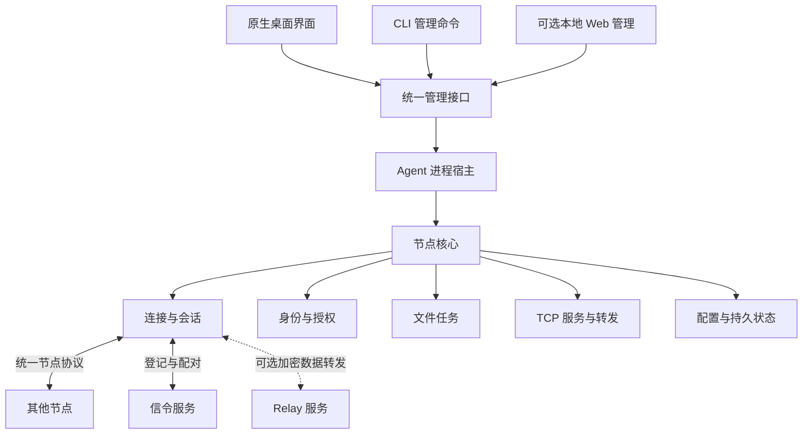

# 统一节点架构设计

- 文档编号：ARCH-NODE-001
- 状态：目标设计，待分阶段实现；本文不表示功能已上线或互通验收通过
- 日期：2026-10-20（Asia/Shanghai）
- 代码审视基线：`eb4b9d9a0b8eb6994faa2c645cb90e841b711b30`
- 配套：[迁移、缺陷修复与验收计划](NODE_MIGRATION_PLAN.md)

实施入口：[Agent 执行任务与审核流程](NODE_EXECUTION_TASKS.md)

## 1. 目的与范围

将项目收敛为“一套节点核心、一个后台节点服务、多个管理入口”。CLI、原生桌面界面和可选 Web 页管理同一套节点能力；设备间协议不因有无图形界面而不同。

首要场景：

| 设备 | 部署形态 | 职责 |
| --- | --- | --- |
| 老家 Ubuntu Server | 无界面 Agent，由 systemd 托管 | 同时接受多个已授权设备，提供明确授权的 TCP 服务；文件服务按配置启用 |
| 办公室 macOS | Agent + 原生桌面界面 | 连接老家节点，通过界面管理本机转发和文件任务 |
| 家里 Windows | Agent + 原生桌面界面 | 与 macOS 独立且可同时访问老家节点 |
| 阿里云 Ubuntu Server | 信令服务，可选 Relay 服务 | 设备登记、发现、配对；启用 Relay 时转发端到端加密的数据报 |

范围包括文件/目录传输、TCP 转发、测速、诊断、长期在线和配置管理。文件传输保留为一级业务能力，不因以端口转发为首要场景而退化。

本轮不引入全网段 VPN、UDP 业务转发、远程桌面、任意远程文件系统管理、云账号平台或浏览器直接参与 P2P。本地 Web 管理不等于浏览器具备 P2P 协议栈。

## 2. 当前状态与问题来源

以下为基线源码事实，不能用目标设计覆盖这些现状：

| 层次 | 基线实现 | 需要收敛的边界 |
| --- | --- | --- |
| 身份与网络基础 | `identity`、`transport`、`nat`、`net`、`discovery`、`relay` 已共享 | 保留已验证的身份绑定和网络基础 |
| CLI 会话 | `main.rs`、`tunnel/mod.rs`、`tunnel/supervisor.rs` | `serve` 单对端；服务编排与 TCP 业务混杂 |
| 桌面会话 | `desktop/session.rs` | 多对端、授权和恢复能力位于桌面目录，核心被界面分类绑定 |
| 文件协议 | CLI `ControlMessage`；桌面 `Frame/Message` | 两套线上消息、任务流程和完成语义，并非仅展示差异 |
| 文件基础 | 共用 `FileManifest`、分片/位图及部分 `storage` 实现 | 共享结构不等于协议互通；保留落盘、恢复和发布正确性 |
| TCP 转发 | 共用部分搬运函数和规则模型，分别使用 CLI/桌面消息适配 | 规则管理、开流和重连仍分为两条链路 |
| 授权 | CLI 节点/目标白名单；桌面密码、可信设备、方向授权及目标白名单 | 统一授权模型，但不把旧白名单伪装成密码认证 |
| 配置 | 桌面设置、CLI JSON、SIGHUP、Web 应用流程 | 写入所有权、并发更新、失败恢复及状态展示需要统一 |

`src/lib.rs` 将整个 `desktop` 模块置于 `gui` 特性后；其中的远程认证、任务存储、传输服务并非图形能力。现有桌面设计为保留 CLI 线格式而明确新增独立业务协议，见 [历史技术方案](gpui-mvp/TECHNICAL.md)。这解释了分叉，但不应成为继续发展两套新功能的依据。

事实入口：[CLI 消息](../src/protocol/message.rs)、[桌面协议](../src/desktop/protocol.rs)、[桌面会话](../src/desktop/session.rs)、[文件服务](../src/desktop/transfer.rs)、[CLI 服务](../src/tunnel/mod.rs)、[动态规则](CLI_DYNAMIC_TUNNEL.md)。

## 3. 核心架构决策

| 决策 | 内容 |
| --- | --- |
| D01：节点是通信角色 | “CLI”“桌面”不再作为协议角色；节点可同时主动发起和被动接受连接 |
| D02：核心库共享 | 提取无 GUI 依赖的 Rust 核心；不通过执行 CLI 子命令和解析终端文本复用业务 |
| D03：Agent 单一所有者 | 正式常驻形态中，一个身份、一个数据目录由一个 Agent 独占；管理入口不重复登记或持有业务 socket |
| D04：统一节点间协议 | 新能力进入统一协议族；文件、隧道、测速通过能力协商和独立业务流承载 |
| D05：接口与传输分离 | 核心命令/结果/事件先支持进程内调用，再映射到本地 IPC；公开契约不暴露 GPUI 或 Quinn 对象 |
| D06：配置统一提交 | 所有入口走同一个配置服务；配置版本、实际应用状态与失败信息可查询 |
| D07：能力不等于权限 | 对端支持某能力，不代表当前身份被授权使用；每项操作必须检查方向和资源权限 |
| D08：兼容显式管理 | 旧协议隔离为适配器；认证失败不触发自动降级，不静默改写身份或文件策略 |

初期抽取阶段允许 GUI 内嵌核心，作为行为保持的过渡方式。正式常驻目标是 GUI、CLI 和 Web 管理同一 Agent；不能无限期保持两种运行形态各自增加业务逻辑。

## 4. 逻辑结构与职责

下面是逻辑模块，不要求第一阶段就拆成多个 Cargo crate。先稳定依赖方向，再按构建和发布需求决定物理拆包。

| 模块 | 必须负责 | 不应负责 |
| --- | --- | --- |
| `identity/auth` | 稳定 NodeId、凭据、可信设备、方向与资源授权、撤销 | 窗口、命令行提示、信令代替业务授权 |
| `discovery/network` | 信令与 LAN 发现、候选、STUN、探测、地址族、Direct/Relay | 文件和转发业务规则 |
| `session` | 多 peer、会话代际、认证与能力协商、流路由、重连、资源上限 | 表单状态、文件发布策略 |
| `files` | 文件/目录任务、扫描与差异、调度、暂停/续传、完成回执、限速、空间预算 | UI 事件循环、任意远程路径访问 |
| `tunnels` | 发布服务、节点目标白名单、本地监听、规则生命周期和 TCP 搬运 | 信令服务器、文件业务分发 |
| `speed/diagnostics` | 测速、路径、统计、脱敏诊断与有类型的错误 | 从展示文本反推运行状态 |
| `state/config` | 校验、版本、单写者、任务记录、迁移、故障恢复 | 每种管理入口自行覆盖同一文件 |
| `control` | 核心命令、结果、快照、事件、本地接口权限 | 在客户端重复实现业务状态机 |
| `agent` | 装配核心、持有运行时、实例锁、启动退出、IPC 宿主 | 具体窗口绘制 |
| `desktop/cli/web` | 收集输入、调用控制接口、展示结果 | 私自持有 peer 连接、直接写核心配置与任务记录 |
| `platform` | 托盘、通知、登录启动、文件选择、系统服务适配 | 跨平台业务协议 |
| `signal-server/relay-server` | 公网基础设施及独立资源治理 | 节点文件任务、远端服务白名单、解密业务 |

依赖方向：展示入口 → 控制契约 → 节点核心 → 网络/存储基础。核心不依赖任何展示入口；平台能力通过窄接口注入。无界面构建不得要求 GPUI、托盘或图形系统开发包。

## 5. 进程、身份与状态所有权

1. Agent 是身份、信令登记、UDP/QUIC、peer registry、任务存储和转发监听的唯一所有者。按身份和数据目录实施跨进程锁，GUI 与 CLI 遇到已运行实例时附着；不得另启同身份网络运行时。
2. 多身份实例必须显式指定不同身份及数据目录。复制同一私钥到另一数据目录也不应成为绕过重复登记的常规部署方法。
3. Ubuntu 用专用服务用户运行 Agent。Mac/Windows 默认使用用户级后台 Agent，由应用管理启动和升级；安装为系统服务属于另行明确的部署模式。
4. 关闭窗口与停止 Agent 分开。后台策略允许时关闭窗口继续工作；“退出并停止服务”是明确动作。UI 崩溃不取消后台任务。
5. 多个 peer 共享节点基础设施，各 peer 有独立会话代际、授权和资源预算。一个 peer 失败不得清除其他 peer。正常情况下业务复用当前有效会话，切换期间允许受控的新旧代交接。
6. 信令暂时断开时保留健康的已认证业务连接；重登、候选刷新和新连接重试独立进行。修改本机身份、显式退出等管理动作另有明确收尾语义。
7. Agent 停止或进程被杀后，TCP 连接不能透明恢复原来的字节流；新 TCP 请求可重连。文件任务依靠持久 checkpoint 恢复，不能把内存进度当作持久完成。

## 6. 协议划分与统一策略

### 6.1 四个独立边界

| 协议边界 | 参与者 | 内容与版本原则 |
| --- | --- | --- |
| 信令 | 节点 ↔ 信令服务 | 登记、短 ID、候选、pairing；与业务协议独立演进 |
| Relay 控制 | 节点 ↔ Relay | 准入、票据、加密数据报转发；不包含文件/TCP 业务语义 |
| 节点间协议 | 节点 ↔ 节点 | 身份绑定、能力与授权、文件/隧道/测速及服务目录 |
| 本地管理 | GUI/CLI/Web ↔ 本机 Agent | 配置、操作、任务、状态、事件；不复用公网业务凭据 |

统一针对节点间业务，不将这些边界塞进一个消息枚举。LAN 与公网可以采用不同发现方法，但进入相同身份、会话和业务流程。Direct 与 Relay 使用相同端到端业务协议；路径变化不是授权来源。

### 6.2 基线协议兼容事实

| 协议 | 基线标识 | 注意事项 |
| --- | --- | --- |
| 现有身份/CLI 消息 | `PROTOCOL_VERSION = 3`，握手域 `p2p_file/handshake/v3` | 此版本同时涉及旧文件完成语义，不能直接把数字当成新节点协议版本 |
| 桌面业务 | `P2PD\x01`、`VERSION = 1` | 独立 Frame/Message，含任务 ID、目录、暂停、增量等扩展 |
| 桌面远程认证 | `P2PA\x01`、版本 1 | 绑定当前身份和 TLS 会话的认证交换 |
| 信令 | 注册 v2，短 ID 扩展 v3 | 与以上业务协议版本不是同一个版本空间 |
| Relay | `\0P2PF-RELAY/1`、版本 1 | 保持独立的线格式和安全边界 |

### 6.3 目标节点会话

顺序为：发现 → 建立 QUIC 路径 → Ed25519 与 TLS 会话绑定验证 → 业务版本/能力协商 → 当前会话授权 → 发布可用业务连接。

- 保留现有身份与 TLS exporter 绑定；只有路由可达或身份握手成功，不能显示“已取得业务访问权限”。
- 统一协议以现有桌面任务语义为主要提取基础，复用已经验证的文件基础及网络代码。协议中删除“Desktop/CLI”作为业务角色的含义。
- 基础协议只要求安全会话和必要控制能力；文件、目录、增量、TCP、测速、服务目录分别协商。关闭文件服务的节点仍可只提供 TCP 转发。
- 支持能力、启用能力、被授权使用能力分开报告。未授权的服务不出现在对端可见目录中。
- 核心版本不兼容则明确拒绝；可选能力缺失仅禁用对应操作。安全必需能力缺失不得静默回退。
- 每条流有明确业务类型和归属，使用统一的有界分发器；文件任务 ID、请求 ID、会话代际不可混用。不得由不同业务同时抢读同一入站流队列。
- 文件、TCP 和测速可共享 QUIC 基础，但保持有界队列、并发额度和公平调度；大文件流量不得无限阻塞交互式 TCP。
- 正式编码规范在迁移 P3 阶段冻结：记录 magic、版本字段、枚举编码、最大长度、错误码、超时、扩展规则和 golden 编解码样本。抽取阶段不抢先改线上字节。

### 6.4 文件服务语义

GUI 选择文件、拖拽目录和 CLI 发送命令最终提交同一种任务，使用同一种线上文件流程。统一清单校验、任务身份、恢复位图、暂停、取消、目录条目、差异预览和完成回执。

接收端在校验、持久 checkpoint、文件发布及必要回执持久化完成之后报告完成；丢失完成回复后重试不得重复覆盖或重复发布。自动恢复与用户手动继续的意图必须区分，显式暂停/取消不能被重连覆盖。

路径由接收端策略限制在授权接收根内。文件任务仅代表用户选定的传输，不隐含远程浏览、删除任意文件或远程 shell 权限。

同名处理是接收策略：旧 CLI 的不覆盖编号与旧桌面的备份后发布都要显式记录和迁移，不能因统一协议而改变结果。新节点配置必须明确冲突策略；发送方不能替接收方决定覆盖权限。

### 6.5 TCP 服务与本机转发

区分“本节点发布的服务”和“本机要连接远端服务的转发规则”：

- 发布服务：稳定 service ID、名称、具体目标 IP:端口、启用状态、允许的 NodeId。空授权列表不授予访问。
- 本机转发：规则 ID、远端 NodeId、远端 service ID、本机 loopback 监听、启用/自动启动意图。Mac 与 Windows 各自保存自己的规则。
- 新协议提供仅含当前 peer 可用服务的只读服务目录。客户端可以选服务并建立本地转发；最终开流时服务端仍重新检查授权和当前目标，不能信任缓存目录。
- 旧协议的裸 IP:端口请求由兼容适配器按精确白名单处理；不能借兼容入口开放任意局域网地址。
- 无可用会话时规则进入等待状态并给出原因，支持停止/删除；禁止每条规则启动一个独立身份登记。
- 一个本机 TCP 连接对应一条业务流。删除规则停止接受新连接；目标变更对新流生效；已有流的收尾遵守下一节的撤销策略。

### 6.6 授权与撤销

身份、会话授权、资源权限、管理权限是四层判断。可信设备可免去重复输入密码，但不自动获得所有文件/TCP 资源，也不自动获得管理其他节点配置的权限。

无界面节点必须提供本地管理方式初始化凭据、显式登记可信 NodeId、查询和撤销授权。允许管理员预置信任，但必须标记授权来源；不能伪造“已通过密码验证”的记录。

普通服务停用/目标撤销默认阻止提交后的新流，已打开的业务流自然结束；提供独立、明确的立即断开操作。设备信任撤销、密码轮换或安全性禁用设备按强撤销处理，失效当前授权并关闭受影响的连接/任务尝试。产品界面和 CLI 必须说明这两类动作的不同影响。

权限检查发生在新业务被接纳时；已排队但尚未接纳的操作需按新策略重新验证。权限撤销与开流竞争必须有明确提交顺序，不能只在首次连接时检查一次。

## 7. 统一管理契约与配置一致性

### 7.1 管理接口

核心提供有类型的命令、结果、快照和事件，例如节点状态、连接 peer、配置预检查/应用、文件任务控制、转发规则控制和诊断导出。具体命令名在接口阶段冻结，这些描述不是现有 CLI 使用说明。

IPC 默认使用 Unix domain socket 或 Windows named pipe，并限制到实例所属用户；本地 Web 通过受控适配器访问同一控制服务，沿用 loopback、独立 token、Host/Origin 和请求上限约束。普通 peer 业务协议不暴露此管理 API。

每次变更携带 request ID 和预期配置 revision。重复提交具有幂等结果；revision 冲突返回明确错误。事件带序号，客户端发现断档后重新读取权威快照。GUI、CLI、Web 不解析日志来推断成功。

状态至少区分：期望配置 revision、当前应用 revision、配置提交状态、peer 连接/授权状态、每条规则的监听/等待/失败状态、最近操作错误。目标离线不影响本地管理入口可用。

### 7.2 配置提交模型

所有配置变更（包括 SIGHUP 导入）在同一个更新协调器中串行提交：

1. 解析完整候选配置，验证 schema、权限、revision、身份和资源约束。
2. 计算差异，准备新资源。新监听完成 bind 但暂不接纳业务；保留旧监听和旧配置。
3. 持久化候选及恢复信息，在提交点之前失败则释放候选，保留已提交状态。
4. 进入提交点，切换有效策略和监听接纳状态，停止被替换监听的新接入；完成状态发布。
5. 返回已提交 revision；异常时返回可诊断的失败或恢复中状态，不能把“已尝试回滚”报告为成功。

文件替换、OS socket 与内存状态不是跨资源 ACID 事务。必须通过准备、提交记录和启动恢复保证可解释的一致性：提交前仍以旧配置为准；提交后即使进程中断也按已提交配置恢复，不能悄悄恢复已撤销权限。恢复无法绑定端口时报告该规则失败，不把期望状态冒充运行状态。

端口互换或其他不能在保留旧监听时完成准备的修改，第一版明确拒绝并保持原状态，提示先停用相关规则或分步修改；不声称支持无中断原子端口交换。Windows 禁止以删除旧文件后再 rename 作为可靠配置提交机制；选用可验证的平台替换流程。

手改 JSON 是候选输入，SIGHUP 表示请求导入。已提交配置保留独立可恢复快照；外部文件写错不能破坏最近有效状态。Web、CLI 和 SIGHUP 的并发更新使用同一个 revision 和提交机制。

## 8. 兼容承诺

兼容分为命令入口、线上协议、身份/配置数据和行为语义，不能用“兼容 CLI”笼统替代。完整矩阵见 [迁移计划第 3 节](NODE_MIGRATION_PLAN.md#3-兼容范围与升级策略)。

- 初期保持旧命令、原线格式和默认文件行为，抽取共享实现不改变版本号或枚举序号。
- 新功能仅进入统一节点核心和协议；旧协议适配器只维护兼容与必要安全修复。
- 旧 peer 使用显式配置的兼容模式；协商失败、错误密码或超时不触发旧认证方式重试。
- 兼容适配器应由同一 Agent 持有网络和身份，禁止为同一身份额外启动旧守护进程。单 Agent 内无法证明安全区分的组合，明确判为不支持并要求升级。
- 保留 NodeId、私钥、任务身份、信任记录来源和文件冲突策略；短 ID 由原信令数据库决定，不承诺换信令服务器后数字不变。
- 数据迁移有版本检查、备份、日志和回退条件；新版本已接收文件或创建任务后，不能通过盲目恢复旧数据库回退。

## 9. 与已有文档的关系

本文规定后续目标边界，不覆盖基线部署说明。原 [架构说明](ARCHITECTURE.md)、[远程认证](REMOTE_AUTH.md)、[可信设备](TRUSTED_DEVICES.md)、[CLI 动态转发](CLI_DYNAMIC_TUNNEL.md)、[Web 管理](WEB_ADMIN.md) 和历史 ADR 继续用于理解各自实现阶段。

每个迁移阶段交付时同步更新对应说明，并附代码版本与验证证据。目标能力只有满足配套验收标准后才能标记完成；三项已知缺陷修复、协议统一和四设备实际部署分别验收。
